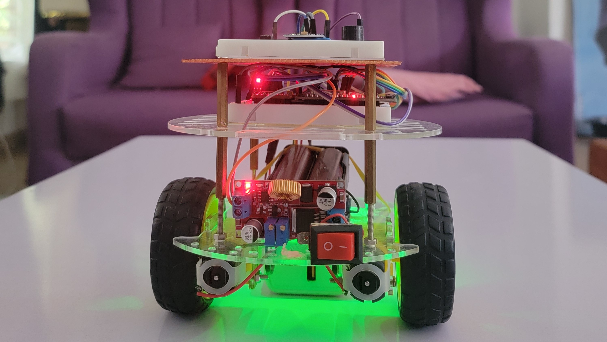
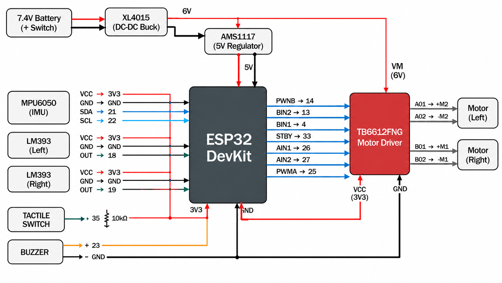

<h1 align="center">POISE</h1>

<p align="center"><b>A calibrated, PID-controlled, PS4-driven two-wheel self-balancing robot built on the ESP32</b></p>

<p align="center">
  
</p>

<p align="center">
  <a href="#goals">Goals</a> |
  <a href="#applications">Applications</a> |
  <a href="#hardware">Hardware</a> |
  <a href="#assembly">Assembly</a> |
  <a href="#calibration">Calibration</a> |
  <a href="#finish">Finish</a> |
  <a href="#limitations">Limitations</a> |
  <a href="#repository-structure">Structure</a> |
  <a href="#getting-started">Setup</a>
</p>

---

## Introduction

An MPU6050 measures tilt, an ESP32 runs a 250 Hz PID loop, and a TB6612FNG drives two TT gear motors to keep the robot upright. Before balancing, the motors are speed-matched with wheel encoders and the IMU is calibrated. Once balanced, the robot is driven from a PS4 controller over Bluetooth.

Every subsystem is verified in its own stage first: encoders, motor matching, IMU, then balancing.

| At a glance |                                                      |
| ----------- | ---------------------------------------------------- |
| Controller  | ESP32 DevKit (esp32dev)                              |
| Sensor      | MPU6050, complementary filter (alpha 0.98) at 250 Hz |
| Actuation   | TB6612FNG driver, 2 x TT gear motors                 |
| Feedback    | 2 x LM393 encoders (used for motor matching)         |
| Control     | PID, tuned live over serial                          |
| Remote      | PS4 controller through Bluepad32                     |
| Power       | 7.4 V battery, 6 V motor rail, 5 V logic supply      |

---

## Goals

- Build a two-wheel self-balancing robot around the ESP32.
- Verify each subsystem on its own before combining them.
- Match the left and right motors so the same command gives the same wheel speed.
- Estimate tilt from a calibrated MPU6050 and hold the robot upright with PID control.
- Drive the robot from a PS4 controller without breaking the balance loop.
- Record the limitations and the routes for improvement.

---

## Applications

- Teaching platform for PID control, sensor fusion and inverted pendulum dynamics.
- Base for balancing mobile robots such as indoor carriers and telepresence units.
- Reusable calibration workflow for low-cost IMUs, DC gear motors and encoders.
- Testbed for trying other controllers on the same hardware.

---

## Hardware

| Component                                  | Qty | Role                                  |
| ------------------------------------------ | :-: | ------------------------------------- |
| ESP32 DevKit                               |  1  | Controller and Bluetooth              |
| TB6612FNG motor driver                     |  1  | Dual H-bridge                         |
| MPU6050                                    |  1  | Accelerometer and gyroscope           |
| TT gear motor                              |  2  | Drive                                 |
| LM393 speed sensor module + encoder disc   |  2  | Wheel speed for motor matching        |
| XL4015 buck converter                      |  1  | 7.4 V to 6 V motor rail               |
| AMS1117 5 V regulator                      |  1  | 6 V to 5 V for the ESP32 VIN          |
| 7.4 V battery with on/off switch           |  1  | Power                                 |
| Passive buzzer                             |  1  | Status beeps                          |
| Tactile switch with 10 kOhm pull-up        |  1  | Speed-test button (calibration)       |
| 3-tier acrylic chassis kit                 |  1  | Frame                                 |
| Breadboards and jumper wires               |  -  | Prototype wiring                      |
| PS4 controller                             |  1  | Remote                                |

---

## Assembly

### Schematic

<p align="center">
  
</p>

### Connections

**TB6612FNG to ESP32**

| TB6612FNG   | Connects to                |
| ----------- | -------------------------- |
| PWMA        | GPIO 25                    |
| AIN1        | GPIO 26                    |
| AIN2        | GPIO 27                    |
| PWMB        | GPIO 14                    |
| BIN1        | GPIO 4                     |
| BIN2        | GPIO 13                    |
| STBY        | GPIO 33                    |
| VCC         | 3V3                        |
| VM          | 6 V rail                   |
| GND         | GND                        |
| BO1 / BO2   | Right motor (M1), + / -    |
| AO1 / AO2   | Left motor (M2), + / -     |

**MPU6050 to ESP32**

| MPU6050 | Connects to |
| ------- | ----------- |
| VCC     | 3V3         |
| GND     | GND         |
| SDA     | GPIO 21     |
| SCL     | GPIO 22     |

**Encoders, buzzer and switch**

| Part                       | Pin          | Connects to                      |
| -------------------------- | ------------ | -------------------------------- |
| LM393 module 1 (left)      | OUT          | GPIO 18                          |
| LM393 module 2 (right)     | OUT          | GPIO 19                          |
| LM393 modules              | VCC / GND    | 3V3 / GND                        |
| Buzzer                     | + / -        | GPIO 23 / GND                    |
| Tactile switch             | one side     | GPIO 35, with 10 kOhm pull-up    |

### Power

```
7.4 V battery --> switch --> XL4015 --> 6 V --+--> TB6612FNG VM
                                              |
                                              +--> AMS1117 --> 5 V --> ESP32 VIN
```

All grounds are common.

### Build notes

- Mount the MPU6050 rigidly: X forward, Y along the wheel axle, Z up.
- Align each LM393 module over its encoder disc.
- Set the XL4015 to 6 V before connecting the load.
- Keep the battery and other heavy parts in a fixed position. The balance point is calibrated for that layout, so recalibrate it if the layout changes.
- Motor A is left and motor B is right. Set `LEFT_DIR` or `RIGHT_DIR` to -1 if a wheel spins the wrong way.

---

## Calibration

Run the stages in order. Usage steps are in the header comment of each sketch.

| Stage | Sketch                                              | Purpose                                                                                   | Result                              |
| :---: | --------------------------------------------------- | ----------------------------------------------------------------------------------------- | ----------------------------------- |
| 1     | `encoder_test.cpp`                                  | Count encoder pulses over 10 wheel turns                                                  | Counts per revolution (40 in use)   |
| 2     | `motor_calibration_fixed_reference.cpp`             | Coarse match: right motor held at PWM 200, left adjusted until speeds agree within 3%     | Approximate left PWM                |
| 3     | `motor_calibration_targeted_references.cpp`         | Fine match: coarse then fine PWM search, five confirmation runs, accepted within 3.5%     | Left PWM matched to right           |
| 4     | `MPU6050_Calibration_and_Live_Data_Generator.cpp`   | 6-face accelerometer calibration, gyro bias, balance point                                | Calibration record in flash         |
| 5     | `PID_calibration.cpp`                               | Balance with live PID tuning over serial                                                  | Kp, Ki, Kd and trim saved to flash  |
| Check | `ps4_dpad_test.cpp`                                 | Print D-pad and button values from the controller                                         | Verification only                   |

The matched PWM values are set in the balancing sketches as `RIGHT_REF_PWM` (200) and `LEFT_MATCH_PWM` (140).


<table align="center">
  <tr>
    <td align="center" width="50%">
      <video src="resources/matching.mp4"
             autoplay loop muted playsinline width="100%">
      </video>
    </td>
    <td align="center" width="50%">
      <video src="resources/PID_Balancing.mp4"
             autoplay loop muted playsinline width="100%">
      </video>
    </td>
  </tr>
  <tr>
    <td align="center">
      <sub>Motor speed matching and test</sub>
    </td>
    <td align="center">
      <sub>PID balancing</sub>
    </td>
  </tr>
</table>


---

## Finish

### Final firmware: `src/ps4_drive.cpp`

- 250 Hz loop. A complementary filter (alpha 0.98) fuses gyro rate and accelerometer angle.
- PID on tilt error: `output = Kp x error + Ki x integral + Kd x rate`, limited to +/-255 PWM.
- Starting gains: Kp 20, Ki 0, Kd 0.8, tuned live over serial and saved to flash.
- Engages after the robot is held within 5 degrees of upright for 1 s. Motors cut beyond 35 degrees.
- The left wheel output is scaled by `LEFT_MATCH_PWM / RIGHT_REF_PWM` (0.70).

### Driving

The D-pad never commands the wheels directly. Each press nudges the balance loop and lets it catch itself.

| Input            | Action                                                                |
| ---------------- | --------------------------------------------------------------------- |
| D-pad Up / Down  | Short forward / backward lean pulses, repeated while held             |
| D-pad Left / Right | Differential wheel steering, with balance kept as the priority      |
| L1 (hold)        | Gentle mode: half the lean and half the steering                      |
| Circle           | Stop: motors off, hold the robot upright for 1 s to re-engage         |
| Controller lost  | Commands fade to zero and the robot keeps balancing in place          |

<p align="center">
  <video src="resources/driving.mp4" controls muted width="60%">
    <a href="resources/driving.mp4">Poise driven with the PS4 controller (video)</a>
  </video>
</p>

### Code overview

| File                                  | Description                                                               |
| ------------------------------------- | ------------------------------------------------------------------------- |
| `src/ps4_drive.cpp`                   | Final firmware: PID balancing with PS4 D-pad driving                      |
| `include/MpuCal.h`                    | MPU6050 calibration record, flash storage, sensor init and angle helpers  |
| `include/Ps4Input.h`                  | PS4-style wrapper around Bluepad32                                        |
| `Calibration Tools/`                  | One sketch per calibration stage, as listed above                         |

---

## Limitations

- No wheel speed or position loop. The encoders are used only for motor matching, so the robot drifts and cannot hold its position.
- Driving is by lean pulses, not velocity commands, so speed and stopping distance are not controlled.
- Motor matching is a single linear scale found at one PWM and one battery level. It drifts as the battery discharges.
- Steering is open-loop differential PWM with no heading feedback.
- TT gear motors have backlash and a PWM deadband, which limit fine corrections.
- Lean limits are small by design (3 degrees default, 10 degree cap), which caps speed.
- The robot does not recover from a fall. It must be lifted upright and held for 1 s.
- Breadboard and jumper wiring is prone to loose connections.
- One PS4 controller at a time.

---

## Future Work

- Cascaded wheel speed loop using the encoders, for speed commands and position hold.
- Battery voltage compensation for the PWM output and the motor match.
- Custom PCB to replace the breadboard wiring.
- Higher resolution encoders and motors with less backlash.
- Heading hold using the gyro Z axis.

---

## Repository Structure

```
Self-balancing-Robot/
|-- README.md
|-- platformio.ini                      Build environments and dependencies
|-- .gitignore
|-- .vscode/
|   `-- extensions.json
|-- src/
|   `-- ps4_drive.cpp                   Final firmware
|-- include/
|   |-- MpuCal.h                        MPU6050 calibration helpers
|   |-- Ps4Input.h                      Bluepad32 PS4 wrapper
|   `-- README
|-- lib/
|   `-- README
|-- test/
|   `-- README
|-- Calibration Tools/
|   |-- Encoder Test/
|   |   `-- encoder_test.cpp
|   |-- Motor Calibration - Fixed Reference/
|   |   `-- motor_calibration_fixed_reference.cpp
|   |-- Motor Calibration - Targeted References/
|   |   `-- motor_calibration_targeted_references.cpp
|   |-- MPU6050 Calibration/
|   |   `-- MPU6050_Calibration_and_Live_Data_Generator.cpp
|   |-- PID calibration/
|   |   `-- PID_calibration.cpp
|   `-- Controller Test/
|       `-- ps4_dpad_test.cpp
`-- resources/
    |-- full_robot.jpg
    |-- schematic.png
    |-- matching.mp4
    |-- PID_Balancing.mp4
    `-- driving.mp4
```

---

## Getting Started

**Requirements:** VS Code with PlatformIO, an ESP32 DevKit, and a PS4 controller.

- `platformio.ini` pins `espressif32@6.10.0` with the Bluepad32 Arduino framework and the Adafruit MPU6050, Unified Sensor and BusIO libraries. They install automatically on the first build.
- Build one sketch at a time. Copy the sketch into `src/` and add an environment for it, following the `ps4_drive` entry:

```ini
[env:encoder_test]
build_src_filter = -<*> +<encoder_test.cpp>
```

- Keep `MpuCal.h` and `Ps4Input.h` in `include/`.
- Follow the stages in [Calibration](#calibration), then upload `ps4_drive.cpp`.

---

## Author

Oreoluwa Oyedele - [oretizy03](https://github.com/oretizy03)